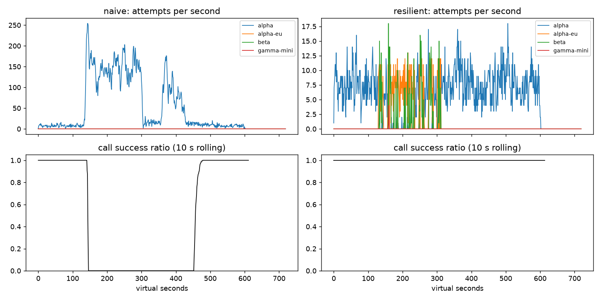

# Lab 25B — Report

**Họ tên / nhóm:** Lê Minh Hiếu — MSV 2A20260282828  **Commit:** 7535bb7  **Điểm tự động (`make grade`):** 84 / 88


> Mọi số dưới đây lấy từ `reports/gameday/*.json`, `reports/cache/*.json`, `reports/workflows.json`, `reports/slo.json`
> (seed 25, cấu hình trong `configs/gameday.yaml`). Các thí nghiệm bật/tắt tham số chạy bằng cách override cấu hình
> trong một script riêng, **không** sửa code nộp bài.

## 1. Kết quả Game Day (naive vs của bạn)

| Băng | Client | availability | p95 (s) | amplification | retry_ratio | cost/turn | recovery (s) | PASS? |
|---|---|---:|---:|---:|---:|---:|---:|:---:|
| G1 | naive | 0,7194 | 7,16 | 7,738 | 6,738 | 2,163 | 4 | ❌ (avail, retry-after, ampl) |
| G1 | yours | 1,0000 | 4,82 | 1,060 | 0,001 | 2,094 | 0 | ✅ |
| G2 | naive | 0,4560 | 15,03 | 9,904 | 8,904 | 4,627 | 155 | ❌ (avail, ampl, recovery) |
| G2 | yours | 1,0000 | 11,87 | 1,058 | 0,007 | 2,164 | 0 | ✅ |
| G3 | naive | 1,0000 | 4,77 | 1,164 | 0,164 | 2,328 | 0 | ❌ (retry_ratio) |
| G3 | yours | 1,0000 | 4,57 | 1,083 | 0,049 | 2,177 | 0 | ✅ |
| G4 | naive | 1,0000 | 13,76 | 1,004 | 0,004 | 2,008 | 0 | ❌ (p95) |
| G4 | yours | 1,0000 | 5,63 | 1,014 | 0,002 | 2,072 | 0 | ✅ |
| G5 | naive | 0,3699 | 5,36 | 17,030 | 16,030 | 2,124 | — | ❌ (400 retries, avail) |
| G5 | yours | 0,8179 | 5,48 | 1,003 | 0,002 | 2,504 | — | ✅ |
| G6 | naive | 0,5170 | 4,84 | 12,344 | 11,344 | 2,009 | 0 | ❌ (avail) |
| G6 | yours | 1,0000 | 6,15 | 1,058 | 0,023 | 2,183 | 0 | ✅ |

Ghi chú thêm: G1 của tôi có 0 `retry_after_violations`; G2/G4/G6 có `primary_share_after_restore = 1,0`; G5 có
0 `client_error_retries`, 0 `unneeded_failovers`; mọi lượt hỏng ở G5 đều là `client_error` (556 lượt — request
malformed thì provider nào cũng từ chối, nên không cứu được). G6 có 0 `incompatible_routes`.

Độ bền: ngoài seed 25, tôi chạy thêm seed 26, 27, 3, 99 và các bản băng tự chế (lệch thời điểm ±30–60 s, kéo dài
sự cố ×1,2–1,3, G2 capacity 0,20, G3 error 35%, G4 +6 s, G6 beta 8 rps, G1 traffic ×2,8): 6/6 băng gốc PASS trên
mọi seed; chỉ fail ở các biến thể mà chính tôi kéo dài hiệu ứng *qua* `restore_at` (G4) hoặc kéo dài cửa sổ
malformed (G5 — mất mát đều là `client_error`, không tránh được).

## 2. Cấu hình client và lý do

Số liệu nền: latency log-normal σ = 0,35 → p99 lúc bình thường ≈ 1,2·e^(2,33·0,35) ≈ **2,7 s** (alpha),
≈ 3,4 s (alpha-eu), ≈ **4,0 s** (beta). Deadline của user 30 s cho **2** call (tool + chat).

| Tham số | Giá trị | Vì sao (dựa trên băng nào, số liệu nào) |
|---|---:|---|
| attempt_timeout_s | 8,0 | ≈ 2× p99 của beta (4,0 s) nên không cắt nhầm call bình thường; 30 s chia cho 2 call vẫn đủ cho 1 lần timeout + 1 lần failover. Thử 30 s → G6 availability 1,0 → **0,949** (108 `deadline`), 20 s → 0,996, 12 s → 0,9996. Thử 4 s → G4 có 96 `client_timeout` (cắt nhầm call 6,2 s đang chạy) và 1 `no_provider_available`. |
| max_attempts_per_provider | 2 | 1 retry cùng provider cứu được lỗi 500 lẻ tẻ của G3 (30% lỗi → 2 lần liên tiếp chỉ 9%) mà retry_ratio vẫn 0,049 ≤ 0,10. Thử 1 → G6 có 3 `no_provider_available`; thử 3 → không cải thiện gì (G2 p95 10,0 s, G3 retry 0,037) mà tăng rủi ro khuếch đại khi breaker chưa mở. |
| backoff_base_s / cap_s | 0,25 / 4,0 | Retry đầu chờ U(0; 0,25 s): rẻ cho lỗi 500 ngắn (G3 p95 4,57 s, gần bằng lúc khỏe). Cap 4 s để retry không bao giờ ăn quá 1/7 deadline. Full jitter → không có sóng retry đồng bộ như naive (G2 naive: đỉnh 250 attempts/s). |
| retry_budget_ratio | 0,1 (min 0,5/s, max 20 token) | Lưới an toàn cuối khi breaker sai: thí nghiệm 1 — breaker hỏng + 5 attempts/provider, G2 amplification 1,378 (có budget) vs 1,597 (không budget), retry_ratio 0,058 vs **0,40**, recovery 0 vs **32 s** (FAIL). |
| breaker.window_size / min_calls | 20 / 10 | 8 call/s → 10 kết quả ≈ 1,3 s traffic: phát hiện nhanh trong G2/G6, nhưng không trip vì 2–3 lỗi lẻ lúc ít traffic. Window 5/3 cũng PASS (G3 ampl 1,021) nhưng 3 lỗi 500 ngẫu nhiên (base error) đã đủ mở breaker — quá nhạy. |
| breaker.failure_rate_threshold | 0,5 | G3 chỉ 30% lỗi < 50% → alpha vẫn phục vụ (retry 1 lần là đủ, primary share 1,0); G2 (529 + timeout gần 100%) và G6 (100% 503/hang) vượt xa 50% → trip trong vài giây. Thử 0,8: vẫn PASS nhưng G3 retry_ratio tăng 0,049 → 0,068 (gần ngưỡng 0,10 hơn). |
| breaker.slow_call_s | 5,0 | G4: alpha trả lời ≈ 1,2 + 5 = 6,2 s, không lỗi. 5 s > p99 của mọi provider lúc khỏe (≤ 4 s) nhưng < 6,2 s → slow-call trip. Thử 8 s → G4 p95 **13,77 s** (FAIL ≤ 10). Với 5 s: p95 5,63 s. |
| breaker.open_duration_s | 10,0 | Thử 3 s → probe vào provider đang ốm quá dày: G4 p95 6,93 s, G6 amplification 1,082. Thử 30 s → vẫn PASS nhưng sau sự cố phải chờ tới 30 s mới thử lại alpha (đắt hơn: beta 1,4/call). 10 s: G2/G6 recovery 0 s, primary share 1,0. |
| breaker.half_open_max_probes | 2 (cần 2 thành công) | Thử 10 probe / 1 thành công → G6 p95 **11,21 s** và G4 p95 8,25 s: một đàn probe cùng treo vào alpha-eu đang `hang`, và 1 probe may mắn đã đóng breaker quá sớm. 2/2 giữ p95 G6 ở 6,15 s. |
| quota_cooldown_s | 300 | Quota là vấn đề billing, không tự hồi trong vài giây; G5 chỉ tốn 2 attempt "trinh sát" (alpha, alpha-eu) rồi cả họ A bị tránh 5 phút. |

Sơ đồ quyết định của `on_error`:

```
lỗi ──classify──►
  CLIENT_ERROR (400/401/403/422) ─ breaker.release ─► GiveUp("client_error")   (không retry, không failover)
  QUOTA_EXHAUSTED (429 quota)    ─ breaker.release ─► cooldown provider 300 s ─► failover ngay (delay 0)
  RATE_LIMITED (429 + retry-after) ─ breaker.release ─► cooldown tới now+retry_after (dùng chung mọi call)
                                                      ─► failover ngay; nếu cả ladder không dùng được:
                                                         chờ cooldown ngắn nhất (≤ 5 s, breaker không OPEN,
                                                         vừa deadline) + jitter U(0, base)
  OVERLOADED / SERVER_ERROR / TIMEOUT ─ breaker.on_failure ─►
        tries < 2  AND  vừa deadline  AND  provider không cooldown  AND  budget.try_acquire()
            ├─ có  ─► Send(cùng provider, delay = full-jitter(tries))  (nếu breaker vừa OPEN → failover)
            └─ không ─► failover sang provider kế tiếp trong ladder (đã lọc tool calling)
ladder hết ─► GiveUp("no_provider_available")
```

Thành công: `breaker.on_success(permit, latency)` (latency ≥ 5 s tính là slow). Bị huỷ vì deadline:
`breaker.release(permit)` để trả slot probe HALF-OPEN.

## 3. Ba thí nghiệm

1. **Retry budget là lớp phòng thủ cuối.** (`breaker.min_calls: 1e9`, `max_attempts_per_provider: 5`)

   | Băng | Budget | availability | amplification | retry_ratio | recovery (s) | give-up | PASS |
   |---|---|---:|---:|---:|---:|---|:---:|
   | G2 | có | 0,9983 | 1,378 | 0,058 | 0 | 4 deadline | ✅ |
   | G2 | tắt | 0,9670 | 1,597 | **0,400** | **32** | 78 deadline | ❌ recovery |
   | G3 | có | 1,0000 | 1,136 | 0,068 | 0 | — | ✅ |
   | G3 | tắt | 1,0000 | 1,162 | **0,158** | 0 | — | ❌ retry_ratio |
   | G2 | tắt, breaker **đúng** | 1,0000 | 1,058 | 0,007 | 0 | — | ✅ |
   | G3 | tắt, breaker **đúng** | 1,0000 | 1,059 | 0,035 | 0 | — | ✅ |

   Khi breaker hỏng, thứ duy nhất chặn retry là budget: nó giới hạn retry ≈ 10% số request mới *bất kể* lỗi
   nhiều tới đâu, nên G2 không rơi vào vòng nghẹt (recovery 0 s thay vì 32 s, 472 lỗi 429 thay vì 54). Khi breaker
   đúng, budget gần như không bị chạm (số y hệt cấu hình mặc định) vì breaker đã cắt traffic vào alpha trước khi
   retry kịp dồn lên. Nhưng hai cơ chế bảo vệ hai thứ khác nhau: breaker là quyết định *theo từng provider* và chỉ
   hoạt động sau `min_calls` kết quả (và có thể bị cấu hình sai, hoặc lỗi rải đều nhiều provider không trip cái
   nào); budget là trần *toàn cục* cho tải retry. Defense in depth → nên có cả hai.

2. **`attempt_timeout_s: 30`.**

   | Băng | timeout | availability | give_up_reasons | p95 (s) |
   |---|---:|---:|---|---:|
   | G6 | 8 | 1,0000 | — | 6,15 |
   | G6 | 30 | **0,9488** ❌ | deadline 108, no_provider_available 14 | 5,48 |
   | G4 | 8 | 1,0000 | — | 5,63 |
   | G4 | 30 | 1,0000 | — | 5,61 |

   Ở G6 alpha-eu `hang` (không bao giờ trả lời). Với timeout 30 s, một call rơi vào alpha-eu sẽ treo tới hết
   deadline của user rồi mới được phép failover → 108 lượt hết hạn. p95 lại *giảm* (6,15 → 5,48 s) vì p95 chỉ tính
   lượt thành công — những lượt treo lâu nhất đã biến mất khỏi mẫu (survivorship bias); vì vậy phải nhìn
   availability trước. G4 gần như không đổi vì alpha vẫn trả lời sau ≈ 6,2 s < 8 s: timeout không bao giờ bắn;
   cái cứu G4 là **slow-call detection** của breaker chứ không phải timeout. Timeout "đúng" phải thoả hai đầu: lớn
   hơn p99 lúc bình thường (≈ 4 s cho beta, để không cắt nhầm) và đủ nhỏ để `deadline của user ≥ số call × (timeout
   + một lần failover)` — với 30 s và 2 call thì ≈ 8 s.

3. **Bỏ lọc tool calling khỏi `ladder()`** (G6): `incompatible_routes = 257`, availability 1,0 → **0,892** (FAIL),
   toàn bộ 257 lượt hỏng có lý do `incompatible_model_output`. Nói theo ngôn ngữ PM: *"Trong 5 phút provider A sập,
   257 khách đang yêu cầu hoàn tiền bị chuyển sang model 'mini' rẻ tiền không biết dùng công cụ tra đơn/hoàn tiền.
   Hệ thống vẫn 'trả lời', còn tính tiền cho câu trả lời đó, nhưng khách không được hoàn tiền — khoảng 1/9 khách
   trong ca đó nhận một câu trả lời vô dụng. Một câu xin lỗi tĩnh còn tốt hơn: ít nhất khách biết thử lại."*

## 4. Workflow hoàn tiền

| Executor | completion | crashes | duplicate refunds | duplicate emails | lost refunds | overpaid | wasted LLM / crash |
|---|---:|---:|---:|---:|---:|---:|---:|
| naive | 100% | 81 | **128** | **81** | 0 | **14.967,00** (1.496.700 cent) | 1,123 |
| yours | 100% | 66 | 0 | 0 | 0 | 0 | 0,303 |

Cách làm: key idempotency = `refund-wf:{session_id}:{step}` (ổn định qua mọi retry/restart, khác nhau giữa
session và step); sau khi một step **thành công** mới `store.put(checkpoint:{session}:{step}, result)`; worker mới
đọc checkpoint và bỏ qua step đã xong; `_retry` chỉ bắt `ServiceError`/`ServiceTimeout`, không bao giờ bắt
`WorkerCrash`.

- **Chỉ idempotency key là chưa đủ:** tiền không bị trả hai lần, nhưng mỗi lần worker chết thì worker mới chạy lại
  *từ đầu*: classify/summarize bằng LLM lại (tốn tiền — naive 1,12 call LLM thừa / crash), và mọi step không có key
  (đọc đơn, LLM) bị lặp. Ngoài ra kết quả các step trước (refund_id) chỉ nằm trong RAM của worker đã chết.
- **Chỉ checkpoint là chưa đủ:** checkpoint chỉ ghi được *sau khi* nhận response. Nếu payment đã chạy nhưng
  response bị mất (`ServiceTimeout`, 10% trong mô phỏng) hoặc worker chết ngay sau commit (4%), sẽ không có
  checkpoint → lần chạy lại gọi refund lần nữa → hoàn tiền trùng. Chỉ key ổn định mới khiến lần gọi lại đó trả về
  kết quả cũ thay vì trả tiền lần hai.
- **Ghi checkpoint *trước* khi gọi payment:** nếu worker chết giữa lúc ghi checkpoint và lúc payment thực sự chạy,
  worker mới thấy checkpoint "đã xong" và bỏ qua step → **hoàn tiền bị mất** (khách không bao giờ nhận tiền) — và
  checkpoint đó chứa một `refund_id` không tồn tại cho bước gửi email.

## 5. Alerting & error budget

| Sự cố | Mong đợi | Naive alerter | Burn-rate alerter | Độ trễ phát hiện (burn-rate) |
|---|---|---|---|---:|
| checkout_bug | page | page (1 phút) | page ✅ | 27 phút (hạn 35) |
| provider_outage | page | page (0 phút) | page ✅ | 4 phút (hạn 8) |
| deploy_blip | none | **page sai** | không page ✅ | — |
| slow_leak | ticket | **không phát hiện** | ticket ✅ (không page) | 1.337 phút ≈ 22,3 h (hạn 30 h) |
| degraded_evening | page | page (214 phút) | page ✅ | 291 phút (hạn 330) |
| night_spike | none | **page sai** | không page ✅ | — |
| small_bump | none | **page sai** | không page ✅ | — |

Naive: 7 page, 3 false page, bỏ sót slow_leak → FAIL. Burn-rate: 3 page, 1 ticket, 0 false page → PASS. (Tôi cũng
sinh lại dữ liệu với 12 seed khác và dời thời điểm sự cố ±10 h: burn-rate alerter PASS cả 12.)

Error budget 30 ngày (`error_budget_report`): 25.901.755 request, budget cho phép 129.508,8 lỗi, thực tế 55.618
lỗi → availability 99,7853%; **đã tiêu 42,95%, còn 57,05%**. **Không** đóng băng release (chỉ freeze khi
budget_remaining ≤ 0), nhưng 43% trong một tháng là đáng để ưu tiên việc reliability cho slow_leak/degraded_evening.

Vì sao `small_bump` (20 phút ở 12% lỗi) không nên đánh thức ai: burn rate trong lúc xảy ra = 0,12 / 0,005 = 24×,
nhưng tính trên cửa sổ 1 h thì chỉ 24 × 20/60 = **8× < 14,4×**, trên 6 h là 24 × 20/360 = **1,3× < 6×**. Tổng cộng
nó chỉ tiêu ≈ 1% budget tháng và đã tự hết. Page là để gọi người dậy xử lý thứ đang đốt budget nhanh tới mức sẽ
hết trong vài giờ/ngày; một sự cố tiêu 1% budget thì nên vào ticket/review, không phải page — page cho những thứ như
vậy là cách nhanh nhất gây alert fatigue khiến on-call bỏ qua page thật.

## 6. Postmortem — Băng G2 với client naive (blameless)



*Nguồn: `reports/gameday/naive_G2_overload_storm_timeseries.csv`, `reports/gameday/naive.json`. Thời gian là
giây ảo; số attempts/s là trung bình trên cửa sổ.*

**Tóm tắt (3 câu):** Lúc t=120 deployment alpha mất 75% GPU trong 3 phút. Lớp gọi LLM của ShopAgent v1 (3 tầng
retry chồng nhau, delay cố định 0,2 s, không breaker, không fallback) đẩy tải vào alpha từ 7,5 lên ~150 attempts/s,
làm tỷ lệ thành công về 0 từ t=142. Alpha đã hồi phục hoàn toàn lúc t=300 nhưng hệ thống tiếp tục sập thêm
155 s (tới t≈455) vì chính lượng retry của mình (metastable failure).

**Ảnh hưởng:** 1.285 / 2.362 lượt user thất bại (availability 45,6%); thời gian sập hoàn toàn ≈ 313 s (t=142 →
t≈455), trong đó **155 s xảy ra sau khi provider đã khỏe**. 34.475 attempt cho 3.481 call (amplification 9,9×),
26.298 lỗi 429 tự gây ra, chi phí/lượt thành công 4,63 (gấp 2,1× bình thường 2,16). Error budget: ở 4 lượt/s, một
tháng có ≈ 10,37 triệu lượt → budget 99,5% = 51.840 lượt lỗi; sự cố này tiêu **≈ 2,5% budget tháng chỉ trong 5 phút**
(tỷ lệ lỗi ≈ 100% → burn rate ≈ 200× trong cửa sổ đó — đủ để page fast-burn).

**Timeline:**

| t (s) | Sự kiện | Bằng chứng (số từ CSV) |
|---:|---|---|
| 0–120 | Bình thường | 7,5 attempts/s vào alpha; 895/895 call thành công (100%) |
| 120 | alpha mất 75% năng lực (trigger) | capacity ≈ 18 server / 4,8 s ≈ 3,75 req/s < 8 call/s tới; hàng đợi bắt đầu dài ra; 120–130: 6,2 attempts/s, 32/32 call vẫn OK (trả từ hàng đợi) |
| 130–140 | Timeout 8 s đầu tiên → tầng SDK/gateway/app bắt đầu retry sau 0,2 s cố định | attempts/s nhảy 6,2 → **51,9**; vẫn 19/19 OK (call cũ) |
| 142 | Tỷ lệ thành công rơi < 50% lần đầu, ngay sau đó về 0 | giây 142: success < 0,5; 140–180: **159 attempts/s**, 0/171 call thành công |
| 140–300 | Retry storm tự duy trì: rate limiter 20 rps bị retry lấp đầy, phần được nhận vào xếp hàng ~10 s rồi 529 hoặc client timeout | 145–152 attempts/s trong 180–300; 0/507 call thành công; tổng 26.298 lỗi 429, 3.194 lỗi 529, 2.737 client_timeout |
| 300 | alpha hồi phục hoàn toàn | capacity trở lại 15 req/s |
| 300–360 | Hệ thống **vẫn** sập | attempts giảm còn 15–23/s (nhiều call vừa cạn 36 attempt / hết deadline), nhưng 0/169 call thành công: server đang xử lý hàng đợi đầy request mà client đã bỏ |
| 360–420 | Sóng retry thứ hai (các call mới gặp hàng đợi cũ → timeout → retry đồng bộ) | **95,5 attempts/s**, 0/252 call thành công |
| 420–450 | Sóng retry tắt dần | 21,5 attempts/s, 0/108 thành công |
| 450–460 | Hàng đợi rỗng, call mới bắt đầu thành công | 45/70 = 64% |
| 455 | Recovery (30 s liên tiếp ≥ 95%) | `recovery_s = 155` |
| 460–480 | Bình thường trở lại | 254/262 = 97%; 480–600: 986/986 = 100%, 8 attempts/s |

**Trigger vs root cause:**
- *Trigger:* alpha mất 75% GPU (t=120–300) — một sự cố provider bình thường, xảy ra hằng tháng và **không** nằm
  trong tầm kiểm soát của chúng ta.
- *Root cause:* lớp gọi LLM khuếch đại tải đúng lúc provider yếu nhất: 3 tầng retry chồng nhau (app 4 × gateway 3 ×
  SDK 3 = tối đa 36 attempt/call), delay cố định 0,2 s không jitter, không tôn trọng retry-after, không có retry
  budget, không có circuit breaker và không có fallback sang alpha-eu/beta. Thiếu các cơ chế giới hạn đó, mỗi lỗi
  tạo ra thêm tải (amplification 9,9×).
- *Vì sao không tự hồi phục sau t=300 (vòng lặp metastable):* (1) Server không huỷ request khi client timeout — hàng
  đợi lúc t=300 đầy những request mà client đã bỏ đi, alpha phải xử lý hết đống "việc chết" đó (~10 s mỗi request
  trong hàng). (2) Vì mỗi request mới phải chờ sau đống đó, nó vượt timeout 8 s → client timeout → retry (sau 0,2 s,
  đồng loạt) → thêm request vào chính hàng đợi đó. (3) Rate limit 20 rps bị retry lấp đầy, nên tải *được nhận vào*
  (~20 req/s) vẫn **lớn hơn** năng lực đã hồi phục (15 req/s) → hàng đợi không bao giờ rút. Vòng lặp chỉ gãy khi
  các call cạn 36 attempt hoặc hết deadline 30 s và tải retry tự giảm xuống dưới năng lực (t≈450).

**Điều gì giúp / điều gì làm tệ hơn:**
- *Giúp:* rate limiter 20 rps của provider cắt bớt phần lớn bão (26.298 attempt bị 429 nhanh thay vì xếp hàng);
  `max_queue_wait_s = 10` khiến server trả 529 thay vì xếp hàng vô hạn; giới hạn 36 attempt / deadline 30 s cuối
  cùng cũng làm bão tắt.
- *Làm tệ hơn:* delay cố định (không jitter) tạo sóng retry đồng bộ (đỉnh 250 attempts/s, sóng thứ hai ở t=360–420);
  bỏ qua retry-after; retry cả lỗi mà provider đang báo "quá tải"; không có breaker nên không ai "ngừng gọi" alpha;
  không fallback dù alpha-eu và beta hoàn toàn khỏe suốt sự cố; timeout 8 s ở cả 3 tầng nên mỗi tầng tự retry độc lập.

**Action items:**

| # | Hành động | Loại | Owner | Cách kiểm chứng |
|---|---|---|---|---|
| 1 | Thay NaiveClient bằng ResilientClient: **một** tầng retry (tắt retry ở gateway & SDK), full jitter, tôn trọng retry-after, retry budget 10% | prevent | Team Platform/LLM Gateway | CI chạy `make compare` trên G2 với 3 seed: amplification ≤ 1,2 (hiện 1,058), `retry_after_violations = 0` trên G1 |
| 2 | Circuit breaker sliding-window theo từng deployment + fallback ladder có lọc tool calling (alpha → alpha-eu → beta → gamma-mini cho chat) | mitigate | Team Platform/LLM Gateway | CI: G2 availability ≥ 99%, recovery ≤ 30 s (hiện 0 s), G6 `incompatible_routes = 0` |
| 3 | Dashboard + alert burn-rate đa cửa sổ (14,4× 1h&5m, 6× 6h&30m) trên availability lượt user; thêm alert khi amplification (attempts/call) > 2 trong 5 phút | detect | Team SRE on-call | Replay `data/sli_30d.csv` (`make slo`): 0 false page, page provider_outage ≤ 8 phút; replay G2 naive phải bắn alert amplification trong ≤ 60 s |
| 4 | Load shedding phía mình: huỷ/không gửi request khi đã quá deadline, cap timeout theo thời gian còn lại của user | mitigate | Team Agent Runtime | G6 `give_up_reasons.deadline` ≈ 0; không có attempt nào gửi đi khi `now ≥ deadline` (assert trong test) |
| 5 | Game Day định kỳ hằng quý với 6 băng + băng ẩn, đưa `make grade` vào pipeline release | prevent | Engineering Manager | Release bị chặn nếu bất kỳ băng nào FAIL |

## 7. Một điểm yếu còn lại

**p95 ở G2 = 11,87 s** (cao gấp ~2,5 lần lúc khỏe, dù vẫn đủ availability). Nguyên nhân: trong ~1–2 s đầu, trước
khi breaker của alpha đủ `min_calls = 10` kết quả để mở, các call đã ở trong hàng đợi đang chậm dần của alpha phải
chờ trọn timeout 8 s rồi mới failover (186 `client_timeout`); mỗi lần breaker half-open thử lại cũng có probe phải
chờ như vậy. Thử nhanh: timeout 6 s + window 10/min 5 → p95 10,2 s; timeout 4 s → 5,2 s nhưng cắt nhầm call bình
thường ở G4 (96 timeout). Cách sửa tốt hơn: **timeout thích ứng** (ví dụ 3× p99 latency trượt của chính provider đó,
kẹp trong [4 s; 8 s]) và **hedged request** — nếu sau p95 lúc khỏe (~2,5 s) chưa có kết quả thì gửi thêm một bản
sang provider kế tiếp và lấy cái về trước, giới hạn bằng chính retry budget để không thành retry storm.

## 8. Cache (Part G)

Số từ `reports/cache/*.json` (`make cache`, seed 25):

| Client | availability | faq_availability | cache_hit_ratio | stale_served | wrong_answers | outdated_answers | cost/turn | PASS? |
|---|---:|---:|---:|---:|---:|---:|---:|:---:|
| resilient (không cache) | 0,8373 | 0,8424 | 0,000 | 0 | 0 | 0 | 1,386 | ❌ (faq_avail, hit) |
| cached (của bạn) | 0,9124 | **0,9645** | **0,652** | 157 | **0** | **3** | **0,915** | ✅ |
| cached (cấu hình starter 0,80 / 600 / 0) | 0,8469 | 0,8587 | 0,742 | 0 | 181 | 80 | 0,921 | ❌ |

Kiểm tra độ bền: cấu hình của tôi PASS C1 trên seed 25, 26, 27, 1, 2 (outdated tối đa 5, faq_availability tối thiểu
0,954) và trên các bản C1 dời ±30–60 s / kéo dài sự cố ×1,3–1,5.

| Tham số `cache:` | Giá trị | Vì sao (số liệu nào) |
|---|---:|---|
| similarity_threshold | 0,91 | Đo trên catalog: paraphrase cùng ý có cosine **0,951–0,984**; hai ý "gần mà khác" (hoàn tiền thế nào vs bao lâu, phí ship nội thành vs tỉnh…) tối đa **0,862**. 0,91 nằm giữa khoảng trống (cách 0,04 mỗi phía). 0,80 → 175 `other_question`; 0,97 → hit giảm 0,652 → 0,579, cost 0,915 → 0,965. |
| ttl_s | 60 | TTL là thứ duy nhất giới hạn `outdated_answers` (bảng phí ship đổi lúc 480 không có webhook). 30 → outdated 2 nhưng hit 0,592; 60 → outdated 3, hit 0,652; 90 → 13 (sát ngưỡng 15, seed 27 đúng 15); 120 → 24 ❌; 300 → 95 ❌. 60 là giá trị lớn nhất còn dư biên an toàn trên mọi seed (outdated ≤ 5). |
| max_stale_s | 600 | Sự cố toàn bộ provider kéo dài 120 s (240–360); một entry lưu ngay trước sự cố phải còn dùng được tới cuối, tức cần `ttl + max_stale ≥ 120 + ε`. 0 → faq_availability **0,873** ❌; 60 → 0,923 ❌; 120 → 0,960; 600 → 0,9645 và dư cho sự cố dài hơn (băng ẩn). Stale chỉ được phục vụ khi provider bỏ cuộc, và webhook vẫn xoá entry kể cả trong cửa sổ stale, nên cửa sổ dài không làm tăng `wrong_answers`. |
| max_entries | 500 | Catalog chỉ có 18 ý chung × 1 phiên bản prompt đang dùng; 500 thừa chỗ, LRU chỉ là chặn trên bộ nhớ. |

Thí nghiệm:

1. **Ngưỡng** (ttl 60, stale 600): 0,80 → hit 0,659, **wrong 175 (toàn bộ `other_question`)**, faq_avail 0,861,
   cost 0,978; 0,91 → hit 0,652, wrong 0, cost 0,915; 0,97 → hit 0,579, wrong 0, cost 0,965. Ở 0,80 các cặp có
   centroid cosine 0,86 bị trả nhầm: "Chính sách hoàn tiền thế nào?" ↔ "Hoàn tiền mất mấy ngày?", "Đổi size" ↔
   "Đổi màu", "Phí ship nội thành" ↔ "Phí ship đi tỉnh", "Hình thức thanh toán" ↔ "COD". Các câu cá nhân không bao
   giờ vào cache nên không xuất hiện `other_user`.
2. **TTL** 30 / 60 / 300 → outdated 2 / 3 / 95, hit 0,592 / 0,652 / 0,731. Webhook chỉ xử lý được những thay đổi
   *được báo* (chính sách hoàn tiền lúc 150 → `invalidate("policy/refund")`, 0 `ignored_invalidation`). Bảng phí ship
   đổi lúc 480 **không** có webhook nên cache không có cách nào biết; câu trả lời cũ chỉ biến mất khi nó hết tuổi.
   Vì vậy TTL là chặn trên duy nhất cho "câu trả lời đúng lúc tạo nhưng đã lỗi thời": số outdated ≈ traffic hỏi về
   phí ship × TTL.
3. **Stale-if-error** `max_stale_s: 0` → faq_availability 0,9645 → **0,8733**, stale_served 157 → 0,
   availability chung 0,912 → 0,857. Không có stale thì trong 120 s mọi provider sập, câu FAQ nào quá 60 s tuổi đều
   thành GiveUp dù cache vẫn còn câu trả lời đúng.

Trả lời:

- **Vì sao không cache câu hỏi cá nhân, kể cả theo từng user?** (1) Embedding của "Đơn #48213 của tôi ở đâu?" và
  "Đơn #48214…" giống nhau ~0,99, nên cache ngữ nghĩa *sẽ* trả đơn của người khác → rò dữ liệu (`other_user`), lỗi
  nghiêm trọng nhất. (2) Dù scope theo user_id, câu trả lời phụ thuộc trạng thái sống của đơn/hoàn tiền/điểm thay đổi
  từng phút mà không có webhook nào báo cho cache — một trạng thái "đang giao" cũ 60 s đã có thể sai (simulator tính
  là `personal_cached`). (3) Tỷ lệ hit gần như bằng 0 (mỗi user hỏi đơn của mình vài lần) nên không có lợi gì để đổi
  lấy rủi ro đó. Cache chỉ cho allowlist câu hỏi chung dựa trên tài liệu.
- **Khi mọi provider sập mà dashboard vẫn xanh nhờ cache, alert dựa trên gì?** Không alert trên availability của
  user (đã bị cache che) mà trên **sức khỏe tầng provider**: (a) tỷ lệ `stale_served / faq_turns` (hoặc stale/s) —
  lúc bình thường = 0, trong C1 nhảy lên 157 lượt trong 2 phút, page khi > vài % trong 5 phút; (b) tỷ lệ thành công
  của attempt tới provider / số breaker đang OPEN (cả 4 OPEN = sự cố); (c) availability của lượt **không** cache được
  (tool call, câu cá nhân) — trong C1 đó là phần làm availability chung tụt từ ~1,0 xuống 0,912. Đồng thời gắn nhãn
  rằng mọi câu trả lời stale là "đang dùng bản lưu", và nhắc rằng cửa sổ stale có hạn (600 s) — sau đó FAQ cũng sẽ sập.
